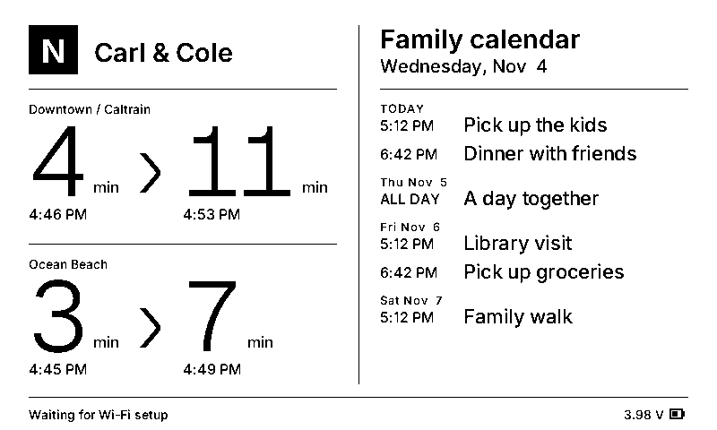

# NTrain

A standalone Muni arrivals and Google Calendar dashboard for the **Seeed Studio reTerminal E1001**. Two configurable transit rows, six upcoming events, and a local USB installer. After setup, the display runs on home Wi-Fi without a computer or cloud gateway.



## Install on your display

You need a monochrome reTerminal E1001, a USB **data** cable, Node.js 22 or later, and desktop Chrome or Edge. E1002 and other panels are not supported.

**Preview release:** browser firmware installation, reconnection and Wi-Fi scanning have passed on physical hardware. The complete first-time provisioning flow still needs validation. See the [validation record](docs/INSTALLER_VALIDATION.md).

Run the installer directly from this project's [GitHub release](https://github.com/guiseiz/ntrain/releases/tag/v0.1.1):

```sh
npx --yes --package=https://github.com/guiseiz/ntrain/releases/download/v0.1.1/ntrain-setup-0.1.1.tgz ntrain-setup
```

Or clone the source:

```sh
git clone https://github.com/guiseiz/ntrain.git
cd ntrain
npm start
```

The prebuilt installer and firmware are included. End users do **not** need `npm install`, Python, PlatformIO, or a compiler.

From a downloaded release package:

```sh
npx --yes --package=./ntrain-setup-0.1.1.tgz ntrain-setup
```

This uses the package attached to our GitHub release. It is not published to the npm registry under the unscoped `ntrain-setup` name.

1. Open the local address in Chrome or Edge and choose the USB display.
2. Install the firmware. Keep USB connected during the approximately 90-second upload.
3. Scan for your 2.4 GHz Wi-Fi network and test the password.
4. Choose a Muni line, direction, and stop for **each of the two rows**. Use the same line twice or mix two lines.
5. Add your own [free 511 API key](https://511.org/open-data/token), and optionally one or two Google Calendar subscription links.
6. Choose active hours, then **Test Wi-Fi & save to display**.

The installer verifies firmware hashes, checks the ESP32-S3 and 32 MB flash, and writes only the four required firmware regions. Installing replaces the existing firmware; the NTrain settings partition is preserved during updates. Never unplug the cable while flashing. If interrupted, reconnect and install again.

[Detailed installation and agent instructions](INSTALL.md) · [Development and firmware architecture](docs/DEVELOPMENT.md) · [Validation record](docs/INSTALLER_VALIDATION.md)

## Give this to your agent

> Set up https://github.com/guiseiz/ntrain on my reTerminal E1001. Read INSTALL.md, check the bundled installer, then start it locally. Help me choose two Muni line/direction/stop combinations and up to two Google calendars. Let me enter credentials in the local form and choose the USB port in Chrome or Edge. Do not publish my configuration or ask me to paste passwords into chat.

## How it works

- Both transit rows use one official 511 GTFS-Realtime Trip Updates request every **61 seconds** during active hours. Use a dedicated key; other apps sharing that key consume the same quota.
- The route dropdown is a bundled snapshot of SFMTA’s official GTFS catalog. It uses each stop’s public `stop_code`, matching the five-digit 511 stop IDs. The catalog does not use your API key. Timetables and temporary stops can change; see [catalog refresh instructions](docs/RELEASING.md).
- Calendars refresh every 15 minutes during active hours. Events from both feeds are sorted together; duplicate invitations appear once. The next six ongoing/upcoming events within seven days are shown.
- The display keeps its last received train numbers through empty or failed responses, with arrival clocks and freshness labels. Retained values can be old; always check the timestamp.
- The device sleeps after updating. E-paper retains the image while asleep. The green right button wakes it, subject to request deadlines. Battery runtime has not been measured for this refresh frequency.

## Calendars and credentials

For private Google calendars, use **Settings → calendar → Integrate calendar → Secret address in iCal format**. If someone shared the calendar with you, ask its owner for the subscription link. A calendar ID or public/embed URL works only for calendars already readable without sign-in.

The installer runs on `127.0.0.1`, serves bundled assets, and has no telemetry or remote script dependency. Wi-Fi details and the 511 key go straight from the browser to USB. Calendar checks send the subscription URL to Google through the local process. Nothing is saved to a local config file by this installer. Credentials are saved in the display’s unencrypted flash. Revoke a calendar secret in Google settings if needed.

## Development

```sh
npm ci
npm run test:installer
npm run build:installer
```

Rebuilding the firmware first requires the pinned Python/PlatformIO toolchain; see [development instructions](docs/DEVELOPMENT.md). The checked-in firmware, generated browser bundle, and package lock are release artifacts. GitHub Actions runs the tests, rebuilds firmware, and produces a downloadable npm package on a version tag. It does not publish to the npm registry automatically.

## License and attribution

Project code and combined firmware are GPL-3.0-only; the display driver is GPLv3. Third-party code, fonts, and transit data retain their licenses. See [LICENSE](LICENSE), [THIRD_PARTY.md](THIRD_PARTY.md), and the bundled notices/source archive. This is an independent project, not an official SFMTA or Seeed product. SFMTA transit data is provided as-is; SFMTA and its personnel are not liable for damages arising from its use.
