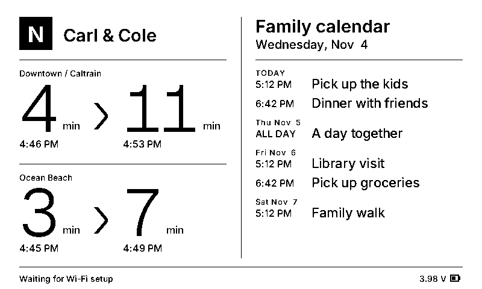

# NTrain · Carl & Cole

A standalone home dashboard for the **Seeed reTerminal E1001**, showing the next two N Judah trains from **Carl & Cole toward downtown (13911) and Ocean Beach (13909)** and a combined agenda from two Google Calendar subscriptions. It runs on the display's own Wi-Fi. No always-on Mac, Raspberry Pi, cloud deployment, or Bluetooth gateway is required.



## Start here

1. Leave the display connected by USB. Disconnect any browser serial monitor first.
2. Run `.venv/bin/python tools/setup_device.py` in this project.
3. Open **http://127.0.0.1:8765**. The page automatically detects the USB port. Click **Scan nearby networks**, choose your Wi-Fi name (not its MAC/BSSID address), and enter the password. **Test Wi-Fi** checks the form's details; **Test saved Wi-Fi** checks the display's existing settings. Both run on the actual device without changing its settings. Only 2.4 GHz networks are visible to this hardware.
4. Enter a [free 511 API key](https://511.org/open-data/token) (the token from their email) and the two Google Calendar subscription links: **Calendar 1** and **Calendar 2**. Either field also accepts an ID or public/embed URL for a publicly readable calendar. **Check both calendars** verifies access without sign-in. Click **Test Wi-Fi & save**. The device verifies Wi-Fi and DHCP before saving live settings; a failed test preserves its previous configuration. The calendar check runs on the Mac; the Wi-Fi test confirms device association and DHCP, not the transit API key. The display then restarts and fetches data independently. Close the setup page and stop the Python process with Ctrl+C.

Find the calendar link in Google Calendar on a computer: **Settings → Settings for my calendars → your family calendar → Integrate calendar → Secret address in iCal format**. For a calendar that is already public, its ID or public/embed URL also works: setup converts it to the public iCal feed. For a private calendar, use the secret URL; an ID/public URL alone does not grant access. If the calendar is under “Other calendars”, obtain this link from its owner. Setup reports inaccessible feeds before changing the device configuration. The secret URL authorizes read access without OAuth or repeated sign-in. Workspace administrators can disable this feature. [Google's instructions](https://support.google.com/calendar/answer/37648)

Choose **Use demo data for now** to verify the layout without credentials. At your request, the screen has no sample labels; the footer says “Waiting for Wi-Fi setup” in commissioning mode. These displayed trains and events are not live. In real mode, an unconfigured source shows an empty/setup state; it never substitutes fake live predictions.

The image remains visible during deep sleep. You do not need to wake the device to read it. Press and release the **green button on the right (KEY0)** to wake the processor; automatic updates also wake it. A button wake respects the existing request intervals and provider backoff. The e-paper image flashes briefly during a full refresh, then stays visible while the processor sleeps again.

## Build and flash from a fresh checkout

Requires Python 3.11+, a C/C++ compiler for desktop tests, and USB access. PlatformIO installs the cross compiler. macOS and Linux work; the USB port name differs.

```sh
python3 -m venv .venv
.venv/bin/python -m pip install -r requirements.txt
.venv/bin/pio pkg install
.venv/bin/python -m pytest -q
.venv/bin/python tools/preview.py
.venv/bin/pio run
.venv/bin/pio run -t upload --upload-port /dev/cu.usbserial-10
.venv/bin/python tools/setup_device.py --port /dev/cu.usbserial-10
```

Linux commonly uses `/dev/ttyUSB0`; add your user to the appropriate serial-access group if needed. Close Chrome's Web Serial connection, Arduino Serial Monitor, and any other serial reader before flashing or setup. The E1001 uses the onboard USB-to-UART bridge, with UART TX43/RX44, so USB CDC is disabled in the build. If automatic reset fails, hold BOOT while pressing RESET, release BOOT, and retry. USB flashing replaces the SenseCraft application.

The checked build pins PlatformIO 6.1.18, Espressif32 6.12.0 / Arduino ESP32 2.0.17, GxEPD2 1.6.4, Adafruit GFX 1.12.1, BusIO 1.17.2, and ArduinoJson 7.4.2. The board profile uses 32 MB QIO flash and 8 MB OPI PSRAM. `lib/libical` vendors the C core of libical 3.0.20; a fresh build does not need CMake or a calendar service.

## Configuration and customization

`config.example.json` documents the complete version-1 settings. Copy it into `private/config.json`, replace placeholders, and set `mock` to `false`, or use the local setup form. To send an existing config:

```sh
.venv/bin/python tools/setup_device.py --port /dev/cu.usbserial-10 --file private/config.json
```

The private directory is git-ignored. The setup form binds only to `127.0.0.1`, checks the request origin and a random anti-CSRF token, never returns saved credentials, and sends them over USB only. Live configuration is acknowledged only after Wi-Fi testing and flash storage succeed. It is validated by the same C++ code on desktop and device; malformed or oversized messages leave the old configuration intact. USB diagnostics report network visibility, login failure and DHCP timeout separately. The missing-511-key prompt does not replace a Wi-Fi error. Configuration is unavailable over Wi-Fi and BLE. The device has no network listener or OTA update endpoint.

| Setting | Default | Meaning |
|---|---|---|
| `stop` | `13911` | SFMTA/511 stop reference for Carl & Cole inbound |
| `route` | `N` | Rail route; NBUS and NOWL are not combined with N |
| Outbound stop | `13909` | Carl & Cole toward Ocean Beach; paired with inbound 13911 |
| `transit_seconds` | `61` | One combined prediction request per interval during active hours |
| `calendar_url`, `calendar_url_2` | empty | Calendar 1 and Calendar 2 subscription URLs; either may be empty |
| `calendar_seconds` | `900` | Each calendar refreshes every 15 minutes in active hours |
| `active_start`, `active_end` | `6`, `23` | Local hours; equal values mean always active, overnight ranges supported |
| `night_seconds` | `1800` | Reduced activity outside active hours |
| `timezone` | `PST8PDT,M3.2.0,M11.1.0` | POSIX rule for America/Los_Angeles, including DST |

Text, spacing, sizes, and layout live in `shared/render.h`. Both the ESP32 and desktop preview call this **same renderer**, including identical 1-bit glyphs. At the user's request, the current design restores the original sturdier Inter text while keeping Geist Mono **Light (300)** for the large arrival numbers. The layout follows Figma 43:455. Both directions share one numeral size: 110 px for normal one- and two-digit times. Two-digit pairs share the final “min” label to preserve the large numbers. Only unusual three-or-more-digit waits need a shared smaller size. Regenerate fonts with `tools/generate_fonts.py`; the open-source fonts and OFL licenses are included in `assets`. `tools/generate_icons.py` converts the original Figma battery and next-train arrow SVGs at their native sizes (17 × 12 and 23.1 × 44, rounded to the pixel grid). The display uses two equal columns: train arrivals on the left and the next **six events** from the combined calendars on the right, grouped by day. Date and row spacing tightens when needed so six different dates fit without shrinking the 22 px event titles. Titles use one line with ellipsis when needed. PNG previews include demo, setup, offline, stale, empty, night, six-date, and same-day agendas.

The [editable Figma file in Seiz](https://www.figma.com/design/i1Zm1OzpfqhNiXNap5Ijfr?node-id=43-455) contains screen states and reusable train-arrival and calendar-event components. The current implementation follows the user's edited frame **43:455**. Figma edits do not automatically update the firmware; implement them in `shared/render.h`, rebuild, and flash. `tools/figma_design.js` records the earlier initial Figma construction, not subsequent edits made by the user.

## How it operates

- A timer wakes the ESP32-S3. It joins Wi-Fi only when a request or clock synchronization is due, retrieves HTTPS data with certificate verification, renders locally, powers down the panel/radio, and deep-sleeps.
- The original BLE companion-service proposal was replaced at your request. Python is used only for installation, provisioning, preview, and testing. There is no service to schedule on another computer. The firmware starts automatically at power-on and schedules itself.
- Transit uses the official 511 **GTFS-Realtime Trip Updates** bulk feed. One request contains both directions; route N and the two directional stop IDs are filtered locally. The bounded protobuf reader accepts full datasets, validates provider timestamps, skips cancelled trips/skipped stops, and sorts/deduplicates the next two arrivals per direction. Separate alert polling is disabled to reserve the request budget for predictions. Legacy SIRI/alert parsers remain covered by tests but are not used in the device fetch loop.
- The configured polling interval is **61 seconds**, throughout active hours. At least 61 seconds separate attempts, including failures, staying within the published **60 requests / 3600 seconds** for a dedicated key. Wi-Fi wakes five seconds early and waits for the request deadline, fitting normal reconnection inside the interval. Slow association or responses can still add delay. There are no immediate retry bursts. Retry-After and increasing backoff apply on failure; deadlines are saved before requests and survive configuration resets. Other clients sharing the same key consume the same quota. Thirty-second polling requires an increased limit.
- The live parser rejects expired predictions, but the display keeps a separate last-received pair for each direction. Failed, empty, stale, or out-of-order responses do not wipe those numbers or replace them with dashes. A newer valid pair replaces the old pair directly after the fetch. Minutes are recomputed on successful receipt; during an outage they freeze, with the absolute predicted arrival clock and a “Last received” timestamp showing their age. Overnight retains this same layout. These retained numbers can be old: they are history, not a guarantee a train is still forthcoming. RTC memory preserves every received pair through deep sleep; NVS checkpoints every five minutes preserve recent history through complete power loss.
- The combined feed measured about 1 MB per download on the Mac, bounded at 2 MiB on the device. This is materially more transfer and awake time than a single-stop request. It needs no server or always-on computer. Refresh remains a single full-panel operation after the request; transit expiry no longer schedules an extra redraw.
- Each calendar feed is fetched independently at most every 15 minutes, or the configured overnight interval. libical expands recurrence rules, EXDATE/RDATE, moved or cancelled individual instances, all-day dates, VTIMEZONE definitions, and DST. The next 16 events from each source in a seven-day window are cached independently, then merged into the earliest 16 overall; three fit on screen. Shared invitation instances are deduplicated by calendar UID and occurrence time. Separate events with identical titles/times remain distinct. The agenda has no source labels. A failed source retains its own cache while the other source can update; a successful empty feed clears only its own events. Removing or changing a source invalidates only its cache. Completed events expire locally. Data older than six hours is visibly marked stale. Calendar updates are committed only after a successful parse, preserving the last good agenda through connection failures and restarts.
- The source update time is separate from the screen's rendering time. The footer battery reading is measured voltage, not an invented precise percentage. Charging voltage is not a reliable state-of-charge estimate.
- Full refresh is the default. Seeed's E1001 documentation and the exact GDEY075T7 driver support partial refresh, but no unverified partial-refresh/ghosting policy is enabled. Identical framebuffers are skipped. The LED, unused SD-card power, ADC divider, Wi-Fi, and display are powered down between cycles.

## Calendar limits and privacy

The private calendar links are bearer secrets. They and Wi-Fi credentials are stored on the display in **unencrypted NVS**, and in a mode-0600 local config file inside a mode-0700 directory. This is the tradeoff for fully standalone operation without a gateway. Someone with physical flash access can recover them. Reset the calendar secret URL in Google Calendar to revoke it. Flash encryption / Secure Boot are not enabled automatically because their fuse provisioning can be irreversible.

The firmware accepts Google's HTTPS iCal URL (`https://calendar.google.com/calendar/ical/.../basic.ics`) and rejects alternate origins and redirects. TLS uses Mozilla roots from certifi, with hostname and certificate verification required. The compact flash bundle avoids exhausting internal RAM for 511. Google uses the small GTS-root subset as full certificates so mbedTLS can terminate its cross-signed chain at an already trusted root. When trust roots change, update `assets/ca-bundle.pem`, run `.venv/bin/python tools/generate_ca_bundle.py`, and rebuild. The generator preserves all compact-bundle anchors and generates `assets/google-roots.pem` solely from that same trusted source.

Parsing is bounded to 1 MiB per feed, 2,500 VEVENTs and 30,000 recurrence iterations. Unknown timezones, sub-daily RRULE frequencies, deprecated EXRULE properties, non-Gregorian recurrences not supported by the bundled libical build, and `RANGE=THISANDFUTURE` overrides fail explicitly instead of silently giving incorrect dates. Ordinary daily/weekly/monthly/yearly family events, individual recurring-instance changes, EXDATE exclusions and all-day events are tested. Google exports commonly include the needed VTIMEZONEs; Pacific time and UTC are bundled when absent. Very large historical feeds may require a smaller dedicated family calendar. This is a calendar subscription, not an instant push channel; Google feed publication/caching may add latency.

## Backup and recovery

`tools/backup.py` makes read-only chunked flash backups. A full backup takes time at a conservative USB baud rate:

```sh
.venv/bin/python tools/backup.py --port /dev/cu.usbserial-10 --baud 115200
```

For this installation, the backup may be named `private/preflash-prefix-2MiB.bin`. It covers addresses **0x000000–0x1fffff**, including every byte this firmware upload, NVS configuration, and OTA-data initialization modify. The remaining original flash is left intact. This is a rollback prefix, **not a standalone full factory image**. Do not erase the whole chip or overwrite higher flash addresses and expect a prefix backup to restore them. Check the accompanying SHA256 file before restoration.

```sh
.venv/bin/python -m esptool --chip esp32s3 --port /dev/cu.usbserial-10 --baud 115200 write_flash 0 private/preflash-prefix-2MiB.bin
```

To restore from a complete 32 MiB backup, use its filename instead. The firmware hub linked from [Seeed's official device page](https://wiki.seeedstudio.com/reterminal_e10xx_main_page/) is another route to the official application; it does not restore your private settings if they were erased.

See [hardware validation](VALIDATION.md), [power measurements](POWER.md), and [verified source references](SOURCES.md).
